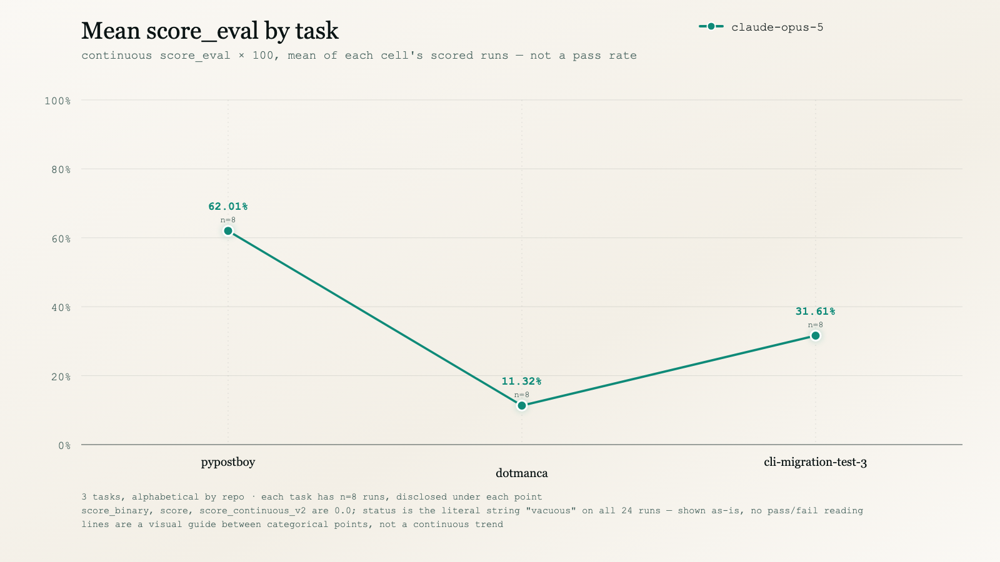

<p align="center">
  
</p>

<p align="center">
  <strong>Real-repository software-migration tasks for coding agents, graded on a continuous, judge-corroborated score — not a pass rate.</strong>
</p>

<p align="center"><sub>
  <a href="#summary">Summary</a> · <a href="#results">Results</a> · <a href="#coverage">Coverage</a> · <a href="#task-list">Tasks</a> · <a href="#repository-structure">Structure</a> · <a href="#scoring-signals">Scoring</a> · <a href="#figures">Figures</a>
</sub></p>

# Thanatos: 3-Task Migration Sample

**Thanatos asks a coding agent to carry out one real, self-contained software migration inside a checked-out repository — a framework rewrite, a test-runner port, or an HTTP-client migration — with existing tests required to keep passing.** Domains below are read directly from each task's `instruction.md`, not inferred: a Flask→Django 5.0.6 rewrite, a unittest→pytest test-suite port, and a requests→async-httpx migration.

This sample is **3 tasks × 1 model** (`claude-opus-5`): every task has exactly **8** runs, and all **24 run directories carry a scored `result.json`**.

## Summary

| Property | Value |
| :--- | :--- |
| Tasks | **3**, across **3** distinct upstream repositories (one task per repository) |
| Model | `claude-opus-5` — the trajectory directory name used throughout; `agent_info.model_info` records `anthropic/claude-opus-5` |
| Run directories | **24** total, all scored (`result.json` present) |
| Per-task runs | **8** per task, across all 3 tasks — see [Task list](#task-list) |
| Primary metric | continuous `verifier_result.scores.score_eval` ∈ [0, 1], reported ×100 — **not** a pass rate |
| `score` / `score_binary` / `score_continuous_v2` | each `0.0` on all 24 scored runs; `verifier_result.status` is the literal string `"vacuous"` on all 24. Shown as-is; this document does not define their semantics or attach a pass/fail reading (see [Scoring signals](#scoring-signals)) |
| Cost | `agent_result.cost_usd`, all 24 scored runs |
| Declared language | 1 declared tag from `task.toml` `keywords[0]` — Python (3); every task carries an explicit `keywords` entry |
| Declared difficulty | from `task.toml` `metadata.difficulty` — `hard` (1), `medium` (1), `easy` (1); a descriptive tag, not a calibrated tier |

| metric | claude-opus-5 |
|---|--:|
| pooled mean `score_eval` (run-weighted) | 34.98% (n=24) |
| task-macro mean `score_eval` (task-weighted) | 34.98% (n=3 tasks) |
| pooled mean agent cost / run | $4.51 |
| task-macro mean agent cost / run | $4.51 |
| total agent cost (scored subset) | $108.18 |
| mean episodes / scored run | 127.4 |

**Pooled** weights every scored run equally; **task-macro** weights every task equally, regardless of its run count. They are reported side by side, but with every task at exactly 8 runs the grid is balanced, so the two coincide here.

## Results

The chart below plots the 3 tasks in fixed alphabetical order. The x-axis is categorical, not a numeric scale, and the connecting line is a visual guide between three fixed positions, not a claim of a trend. Chart labels use the repo-only name (e.g. `pypostboy`); the full `org/repo` is in the [task list](#task-list).

### Mean score_eval by task

<picture>
  <source media="(prefers-color-scheme: dark)" srcset="images/score_eval_by_task-dark.png">
  <source media="(prefers-color-scheme: light)" srcset="images/score_eval_by_task-light.png">
  
</picture>

`claude-opus-5` reads highest on `pypostboy` (62.01% — also its highest cell), then `cli-migration-test-3` (31.61%), and lowest on `dotmanca` (11.32%). This is 3 small cells of 8 runs each, not a stable rate.

## Coverage

<picture>
  <source media="(prefers-color-scheme: dark)" srcset="images/tasks_by_language-dark.png">
  <source media="(prefers-color-scheme: light)" srcset="images/tasks_by_language-light.png">
  
</picture>

**3 tasks, 1 declared language tag (1 category on the chart), from 3 distinct upstream repositories** — every task is a different repository, so there is no repeated-repo adjustment anywhere in this document. Language is `task.toml`'s `[task].keywords[0]` verbatim; all 3 tasks declare `python`. Every task ships a full `[metadata]` section; declared difficulty spans all three tiers — `hard` (1), `medium` (1), `easy` (1).

## Task list

`n` is `scored/total` run directories per task. `score_eval` is that task's mean (×100). Rows are alphabetical by repository.

| task | repo | lang | difficulty | claude-opus-5 n | claude-opus-5 score_eval |
|---|---|:--:|:--:|--:|--:|
| [`394d9d5c`](394d9d5c-357d-56c2-81e5-e0a2d32ab101/) | dan-nor98/pypostboy | python | hard | 8/8 | **62.01%** |
| [`72dcd7c9`](72dcd7c9-00f7-5c07-a9db-749525a450e4/) | evanepio/dotmanca | python | medium | 8/8 | 11.32% |
| [`739bc356`](739bc356-7e4e-5f45-8af0-ada3a0429dde/) | MorAlekss/cli-migration-test-3 | python | easy | 8/8 | 31.61% |

## Repository structure

```
thanatos-samples/
├── README.md
├── LICENSE
├── images/
│   ├── hero.png
│   ├── score_eval_by_task-{light,dark}.{svg,png}
│   ├── cost_by_task-{light,dark}.{svg,png}
│   └── tasks_by_language-{light,dark}.{svg,png}
└── <uuid>/                       # one directory per task (3)
    ├── task.toml                 # identical field shape on all 3 tasks: schema_version, uuid_v5, keywords,
    │                             # metadata.difficulty/category, and verifier/agent/environment config
    ├── instruction.md            # the verbatim prompt handed to the agent -- "# org/repo" on line 1
    ├── environment/              # Dockerfile
    ├── solution/                 # fix.patch, solve.sh, truth.md (human-written reference notes)
    ├── tests/                    # test.sh, test_output.py, run_tests.py, rubrics.json, config.json
    └── trajectories/                 # per-run shape below is identical across all 3 tasks
        └── claude-opus-5/
            └── run_1 … run_8/         # 8 runs in every task -- see the task list
                ├── config.json        # full run configuration
                ├── result.json        # verifier_result.scores + assay, agent_result.cost_usd -- this
                │                      # document's primary numeric source (scored runs only)
                ├── agent/              # trajectory.json, recording.cast, <model>.pane
                ├── artifacts/          # manifest.json
                └── verifier/           # process.json (corroborating per-run score composition detail),
                                        # score.md, final_score.md, test-stdout.md, + one further per-item log
```

During a run the agent sees only the built repository and `instruction.md`; `solution/` and `tests/` are used exclusively by the verifier. The aggregates in this document are derived from each scored run's `result.json`, together with every task's `task.toml`, `instruction.md`, and `tests/rubrics.json` (item counts only); `verifier/process.json` is read only for the one corroborating check described in [Scoring signals](#scoring-signals), not as a source for any aggregate. The further per-item log noted above is not used for any figure; a reader can cross-check it by hand.

## Scoring signals

`verifier_result.scores.score_eval` (continuous, [0, 1]) is the metric this document treats as primary, reported ×100. Stated literally, with no reading attached: on every one of the 24 scored runs, `verifier_result.scores.score`, `score_binary`, and `score_continuous_v2` are each `0.0`, `verifier_result.status` is the literal string `"vacuous"`, and `verifier_result.score_version` is the literal string `"binary"`. Their semantics are not defined anywhere in the data this document reads, and this document does not infer one — it does not say the binary-outcome channel is "broken," does not say the sample has "zero solves," and does not treat a higher `score_eval` on a given run as implying anything about what `score_binary` "should" have been. `score_eval` is a separate, continuous field; nothing here derives it from, or reconciles it against, the always-`0.0` fields.

`verifier_result.assay.completion_status` is the string `complete` on **all 24** scored runs — there is no `incomplete` run in this corpus. Reported as-is; this document does not characterize what `completion_status` measures or attach an outcome reading to the value.

`verifier_result.assay.code_quality.score` is present (non-`null`) on all 24 scored runs; a `null` would be excluded from any quality-touching figure rather than counted as `0`, but that path is unexercised here.

Each task's `tests/rubrics.json` carries 11–12 weighted, judge-scored criteria (35 total across the 3 tasks) evaluated against the agent's final diff. Separately, each scored run's `verifier/process.json` names its own score-composition schema — `thanatos.bucket-composition/v1` — and ships that schema's operands (`bucket_d_score`, `bucket_n_ceiling`, `score_regression_factor`). It does not state how they combine. The relation below is **derived by this document** from those shipped operands, not quoted from the data:

```
score_eval = min(bucket_d_score, bucket_n_ceiling) * score_regression_factor
```

This document then checked that derived relation, using each run's own already-shipped operands from `process.json` against that same run's `score_eval` in `result.json`: it reproduces `score_eval` on all 24 scored runs, largest deviation `4.20e-05` (< 1e-4). Holding on all 24 is the evidence for the derivation, not a restatement of something the file declares. This is a corroborating check performed by reading `process.json` for that purpose alone — `result.json` remains the source for every aggregate this document reports; `process.json` is not read for any of them.

## Figures

The six SVGs under `images/` and their `.png` exports are committed static assets. The `.png` fallbacks referenced from the `<picture>` tags above are browser exports of those exact SVGs, each rendered at its SVG's own native pixel dimensions (1600×900 for the two line charts, 1600×1200 for the language donut). The hero banner (`images/hero.png`, 1760×532) is standalone artwork, not generated data. Every numeric fact in this document is derived from each scored run's `result.json`, together with `task.toml`, `instruction.md`, and `tests/rubrics.json`.

## License

MIT © 2026 Ethara.AI — see [LICENSE](LICENSE).

Upstream repository content referenced by these tasks (`dan-nor98/pypostboy`, `evanepio/dotmanca`, `MorAlekss/cli-migration-test-3`) remains under its own respective license.
