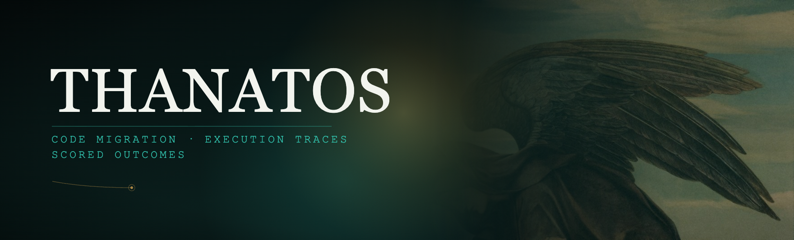
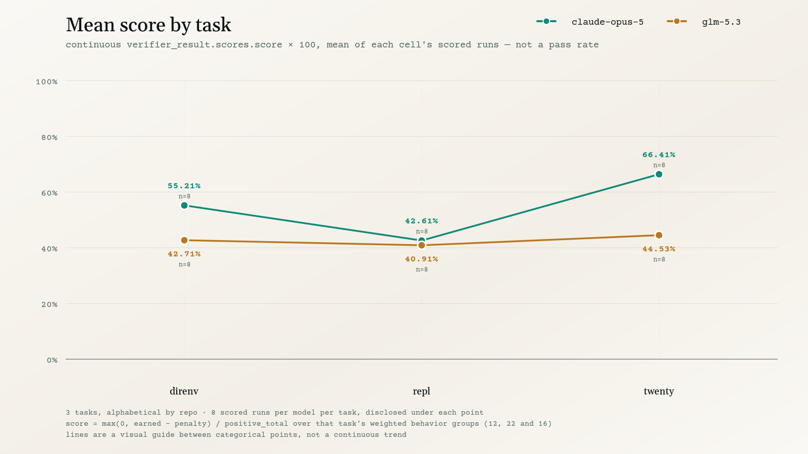
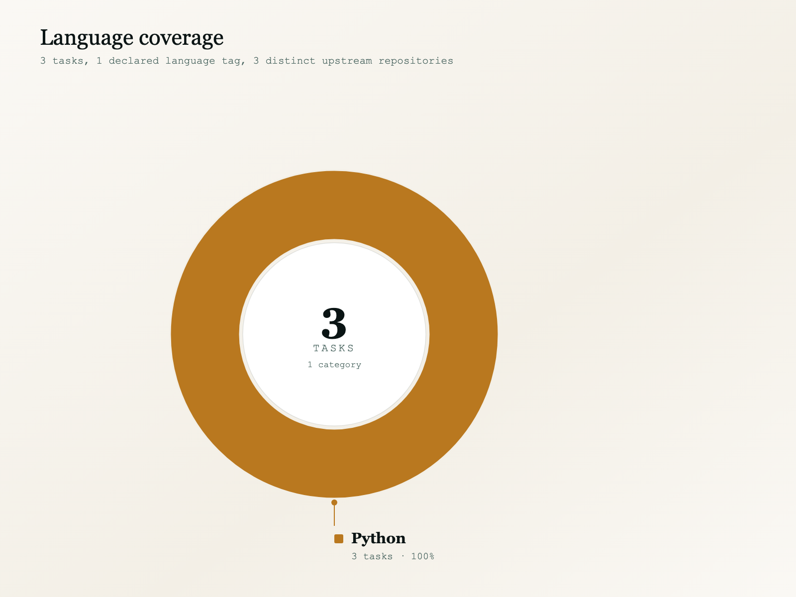

<p align="center">
  
</p>

<p align="center">
  <strong>Real-repository software-migration tasks for coding agents, graded on a continuous, conformance-corroborated score — not a pass rate.</strong>
</p>

<p align="center"><sub>
  <a href="#summary">Summary</a> · <a href="#results">Results</a> · <a href="#coverage">Coverage</a> · <a href="#task-list">Tasks</a> · <a href="#repository-structure">Structure</a> · <a href="#scoring-signals">Scoring</a> · <a href="#figures">Figures</a>
</sub></p>

# Thanatos: 3-Task Migration Sample

**Thanatos asks a coding agent to carry out one real, self-contained software migration inside a checked-out repository — a whole-language port, an authentication-storage rewrite, or a protocol-SDK upgrade — with the task's own conformance suite required to pass.** Domains below are read directly from each task's `instruction.md` and `task.toml`, not inferred: a Go→Rust port of `direnv`, a browser-JWT→persisted-cookie-session rewrite in Twenty, and a migration of Repl's MCP integration from SDK 1.4.1 to 2.2.0 with dual-era protocol semantics.

This sample is **3 tasks × 2 models** (`claude-opus-5`, `glm-5.3`): every task/model cell has exactly **8** runs, and all **48 run directories carry a scored `result.json`**.

## Summary

| Property | Value |
| :--- | :--- |
| Tasks | **3**, across **3** distinct upstream repositories (one task per repository) |
| Models | `claude-opus-5` and `glm-5.3` — the trajectory directory names used throughout; `agent_info.model_info.name` records the same two strings |
| Agent harness | `openhands-sdk` `1.11.5` on every run (`agent_info`); adapter `agent-container:openhands-sdk` |
| Run directories | **48** total, all scored (`result.json` present) |
| Per-cell runs | **8** per task per model — 6 cells, a balanced grid; see [Task list](#task-list) |
| Primary metric | continuous `verifier_result.scores.score` ∈ [0, 1], reported ×100 — **not** a pass rate |
| Score composition | `max(0, earned − penalty) / positive_total` over that task's weighted behavior groups (**12**, **16**, **22**; 50 in total), declared verbatim by each run's `verifier/evaluation.json` and reproduced here on all 48 runs (see [Scoring signals](#scoring-signals)) |
| Cost | `agent_result.cost_usd`, reported for the **24** `claude-opus-5` runs — $46.88/run pooled mean, $1125.04 total |
| Language | `rust` (1), `typescript` (1), `csharp` (1) — `typescript` and `csharp` from `task.toml` `[task].keywords[0]`; `rust` for the `direnv` task, whose instruction is a Go→Rust port |
| Declared difficulty | `task.toml` `[metadata].difficulty` — `expert` on 1 task; the other 2 ship no `difficulty` key. A descriptive tag, not a calibrated tier |
| Declared category | `[metadata].category` — `framework` (2), `language` (1) |

| metric | claude-opus-5 | glm-5.3 |
|---|--:|--:|
| pooled mean `score` (run-weighted) | 54.74% (n=24) | 42.72% (n=24) |
| task-macro mean `score` (task-weighted) | 54.74% (n=3 tasks) | 42.72% (n=3 tasks) |
| mean episodes / scored run | 277.2 | 523.7 |

**Pooled** weights every scored run equally; **task-macro** weights every task equally, regardless of its run count. They are reported side by side, but with every cell at exactly 8 runs the grid is balanced, so the two coincide here. "Episodes" is the length of `agent/trajectory.json`'s `steps` array. Agent cost (`cost_usd`) is reported for `claude-opus-5` only.

## Results

The chart below plots the 3 tasks in fixed alphabetical order by repository name. The x-axis is categorical, not a numeric scale, and the connecting lines are a visual guide between three fixed positions, not a claim of a trend. Chart labels use the repo-only name (e.g. `direnv`); the full `org/repo` is in the [task list](#task-list).

### Mean score by task

<picture>
  <source media="(prefers-color-scheme: dark)" srcset="images/score_by_task-dark.png">
  <source media="(prefers-color-scheme: light)" srcset="images/score_by_task-light.png">
  
</picture>

`claude-opus-5` reads higher than `glm-5.3` on all three tasks. It reads highest on `twenty` (66.41% — also its highest cell), then `direnv` (55.21%), then `repl` (42.61%). `glm-5.3` is flatter across the three: `twenty` 44.53%, `direnv` 42.71%, `repl` 40.91%. On `repl` the two models are 1.70 points apart, the narrowest gap in the grid. These are 6 small cells of 8 runs each, not stable rates.

## Coverage

<picture>
  <source media="(prefers-color-scheme: dark)" srcset="images/tasks_by_language-dark.png">
  <source media="(prefers-color-scheme: light)" srcset="images/tasks_by_language-light.png">
  
</picture>

**3 tasks from 3 distinct upstream repositories** — every task is a different repository, so there is no repeated-repo adjustment anywhere in this document. One task per language: **`rust`** for the `direnv` task (its `instruction.md` is a Go→Rust port, delivered as a Rust crate and executable), **`typescript`** for the Twenty task, and **`csharp`** for the Repl task — the latter two also declared verbatim in `task.toml`'s `[task].keywords[0]`.

## Task list

`n` is `scored/total` run directories per cell. `score` is that cell's mean (×100). `groups` is the task's `weight_total` — the number of weighted behavior groups its score is computed over. Rows are alphabetical by repository name, matching the chart.

| task | repo | lang | groups | claude-opus-5 n | claude-opus-5 score | glm-5.3 n | glm-5.3 score |
|---|---|:--:|--:|--:|--:|--:|--:|
| [`3242f8bb`](3242f8bb-bd4f-5c31-a2a6-663dbc2f3212/) | Zahgon/direnv | rust | 12 | 8/8 | 55.21% | 8/8 | 42.71% |
| [`7035333c`](7035333c-d9a3-530d-89f4-4ff9e95e6f36/) | yllibed/repl | csharp | 22 | 8/8 | 42.61% | 8/8 | 40.91% |
| [`407a8115`](407a8115-5169-55d1-8aea-12b0a93bea74/) | twentyhq/twenty | typescript | 16 | 8/8 | **66.41%** | 8/8 | **44.53%** |

| task | `instruction.md` line 1 | declared scope |
|---|---|---|
| `3242f8bb` | `# Migrate direnv to Rust` | Complete direnv Rust migration with frozen behavioral conformance |
| `7035333c` | `# Migrate Repl's MCP integration to SDK 2.2.0` | Dual-era protocol semantics, concurrent client isolation, roots caching and feedback privacy |
| `407a8115` | `# Migrate Twenty browser authentication to server sessions` | Browser JWT storage → persisted cookie sessions across PostgreSQL, Redis, HTTP, React/Apollo and SSE |

Each task also pins the upstream commits it was cut from — `[metadata].base_commit` plus a reference point (`golden_commit` on `3242f8bb`, `reference_commit` on the other two) — and the two `framework` tasks name the upstream pull request they mirror (`twentyhq/twenty#23642`, `yllibed/repl#71`).

The `407a8115` environment runs PostgreSQL 15; the reference solution (`twentyhq/twenty#23642`) was validated in this environment, and no PostgreSQL 16-specific features are exercised by the schema migration.

## Repository structure

```
thanatos-samples/
├── README.md
├── LICENSE
├── images/
│   ├── hero.png
│   ├── score_by_task-{light,dark}.{svg,png}
│   ├── cost_by_task-{light,dark}.{svg,png}
│   └── tasks_by_language-{light,dark}.{svg,png}
├── grader/                          # source of the rubric grader baked into every grader image
│   ├── rubric_grader.py             # (read-only reference; not needed to run a task)
│   ├── Dockerfile
│   └── README.md
└── <uuid>/                          # one directory per task (3)
    ├── task.toml                    # schema_version 1.4 on all 3: [task] name/version/description/
    │                                # uuid_v5/authors, [metadata], and [verifier]/[agent]/[environment] config
    ├── instruction.md               # the verbatim prompt handed to the agent
    ├── environment/                 # Dockerfile naming the pinned prebuilt image, which already holds
    │                                # the repository at /workspace
    ├── solution/                    # fix.patch, solve.sh, TRUTH.md (human-written reference notes)
    ├── tests/                       # test.sh, test_outputs.py, score_tests.py, config.json,
    │                                # test_weights.json, and the task's rubric file
    ├── trajectory-manifest.json     # per-rollout sha256 of every shipped run document
    ├── trajectory-attestation.json  # merkle root over that manifest
    └── trajectories/                # per-run shape below is identical across all 3 tasks
        ├── claude-opus-5/
        │   ├── manifest.json        # cohort_member, declared/drawn rollouts, per-run grading summary
        │   └── run_1 … run_8/       # 8 runs in every cell -- see the task list
        │       ├── config.json      # full run configuration
        │       ├── result.json      # verifier_result.scores.score, agent_result, thanatos_record --
        │       │                    # this document's primary numeric source
        │       ├── agent/           # trajectory.json (schema_version, session_id, steps, final_metrics)
        │       ├── artifacts/       # manifest.json
        │       └── verifier/        # evaluation.json, score.json, reward.json, outcomes.json,
        │                            # rubric.json, rubric-judge.json, suite_states.json, score.md,
        │                            # final_score.md, test-stdout.md, + per-task logs
        └── glm-5.3/                 # same shape, same 8 runs
```

During a run the agent sees only the built repository and `instruction.md`; `solution/` and `tests/` are used exclusively by the verifier. The aggregates in this document are derived from each scored run's `result.json`, together with every task's `task.toml`, `instruction.md`, and `tests/` rubric and weight files (item counts only); `verifier/evaluation.json` is read only for the corroborating check described in [Scoring signals](#scoring-signals), not as a source for any aggregate. The further per-item verifier logs are not used for any figure; a reader can cross-check them by hand. Each run's `artifacts/manifest.json` declares which optional artifacts were *not* produced and why — on these runs, a terminal recording and a tmux pane dump, because no recorder or multiplexer ran in this harness.

## Scoring signals

`verifier_result.scores.score` (continuous, [0, 1]) is the metric this document treats as primary, reported ×100. It is the only key under `scores` in this corpus; `verifier_result.rewards.reward` carries the identical value on all 48 runs (the four other `rewards` keys — `rubric`, `rubric_cq`, `rubric_if`, `rubric_process` — are advisory rubric shares, covered below, and never enter `score`), and `verifier_result.status` is the literal string `"graded"` on all 48.

Unlike a pass/fail channel, this score is assembled from the task's own conformance suite. Each run's `verifier/evaluation.json` (schema `thanatos.evaluation/v1`) states its composition **literally** under `channels.main.accounting`:

```
score = max(0, earned − penalty) / positive_total
```

with `scorer_profile` = `native-conformance/v1` and `positive_total` equal to the task's `weight_total` — 12 for `direnv`, 16 for `twenty`, 22 for `repl`, with every behavior group carrying weight 1 per that task's `tests/test_weights.json`. This document checked that declared relation against each run's own shipped operands and that same run's `score` in `result.json`: it reproduces `score` exactly on all 48 scored runs, maximum deviation `0.0`. Each run's `evaluation.json` independently reports `agrees_with_published: true`, on all 48. `penalty` is `0.0` on all 48 — no guard fired anywhere in this corpus (`fired_guards` and `broken_guards` are empty throughout).

Reported as-is, with no reading attached: `verifier_result` carries no binary-outcome field in this corpus, so nothing here is derived from, or reconciled against, one. `thanatos_record.scored.reached_full_reward` is `false` and `reason` is the literal string `"below_full_reward"` on all 48 runs; those values are stated, not converted into a solve rate.

`evaluation.json`'s `status` is `complete` and `incomplete_channels` is empty on **all 48** scored runs, and `exception_info` is `null` on all 48. Besides `main`, each run reports four advisory channels — `rubric`, `code_quality`, `instruction_following`, and `process` — all `complete` on all 48 and all marked `contributes_to_main: false` (and `required: false`). They are produced by an LLM rubric judge (`grader.model` in each task's `tests/rubrics.json`) and surfaced as the `verifier_result.rewards.rubric*` keys above; each rubric file's own `reported_as` note states those keys are "never part of reward or score". Accordingly, no advisory value is aggregated anywhere in this document. The grader's source is in [`grader/`](grader/).

The three tasks ship 52 rubric criteria in total, all under `bundle-rubrics/v2` — 17 items for `direnv`, 17 for `twenty`, 18 for `repl` — split per task across the `instruction_following` (4 / 3 / 4), `code_quality` (6 / 7 / 7), and `process` (7 / 7 / 7) dimensions, with every item carrying `contributes_to_main: false`. `verifier/outcomes.json` records the per-group pass/fail — and, per task, the underlying native test counts or failed test-method names — that `earned` is summed from.

All 48 runs end on a `finished` rollout (`thanatos_record.rollout.stop_reason`), and `provenance.terminal_state` is `completed` on all 48. Two `direnv` runs were re-drawn with the same run configuration and seed, and replaced, because the original rollouts did not end normally: `claude-opus-5` `run_4` stopped at the agent's 350-step cap (`stop_reason` `error`) and was re-drawn with a 1000-step cap, finishing in 347 steps; `glm-5.3` `run_1` was cut off when the evaluation host ran out of disk space (`stop_reason` `unreported`) and was re-drawn unchanged. Both replacements were graded by the same verifier and rubric judge as every other run. No run is dropped from any aggregate above.

## Figures

The six SVGs under `images/` and their `.png` exports are committed static assets, regenerated from this corpus. The `.png` fallbacks referenced from the `<picture>` tags above are browser exports of those exact SVGs, each rendered at its SVG's own native pixel dimensions (1600×900 for the line charts, 1600×1200 for the language donut). The hero banner (`images/hero.png`, 1760×532) is standalone artwork, not generated data. Every numeric fact in this document is derived from each scored run's `result.json`, together with `task.toml`, `instruction.md`, and each task's `tests/` rubric and weight files.

## License

MIT © 2026 Ethara.AI — see [LICENSE](LICENSE).

Upstream repository content referenced by these tasks (`Zahgon/direnv`, `twentyhq/twenty`, `yllibed/repl`) remains under its own respective license.
